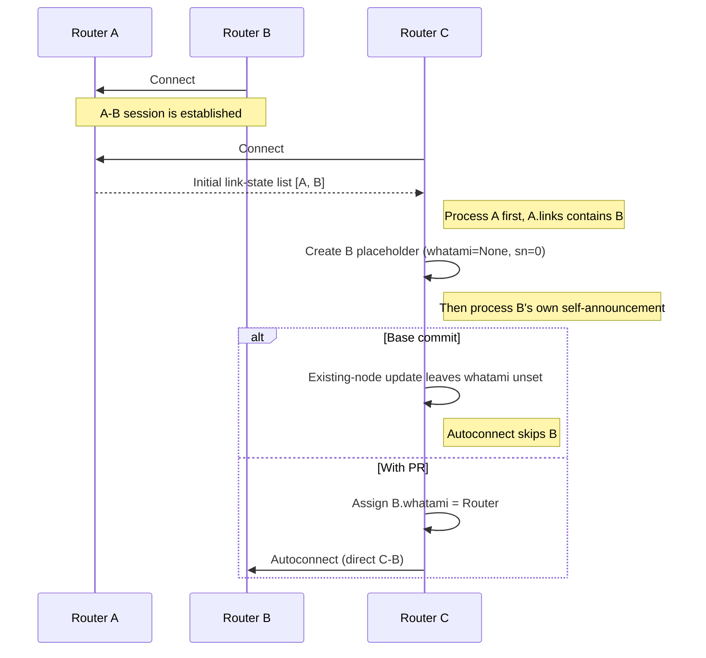

# Zenoh `whatami` regression reproducer

This reproduces the missing node-role assignment addressed by the role-assignment change in [zenoh#2827](https://github.com/eclipse-zenoh/zenoh/pull/2827).

Three real `zenohd` processes create the triggering order: A starts, B connects to A, then C connects to A. C learns about B from A's link map before receiving B's own link state. Without the PR #2827 change, C leaves B's `whatami` unset and does not autoconnect; with the role-assignment change, C learns B's role and establishes a direct connection.



## Run

Requires Bash, Git, Rust/Cargo (default toolchain: 1.97.1), and Python 3.

```bash
bash ./run.sh
```

Use `TOOLCHAIN=stable bash ./run.sh` to select another installed Rust toolchain. The script builds Zenoh at the base commit and with the PR #2827 change, runs the regression test, and attempts up to five process trials per version. Logs and Admin Space snapshots are saved under `.work/`.

The process-level trigger is timing-dependent: an individual trial may miss the required message order, causing the script to stop early. Rerun `bash ./run.sh` if that happens.

## Expected result

| Version | Process result | Regression test |
| --- | --- | --- |
| Base commit | `graph_has_B=yes direct_C_B=no` | Fails: role is `None` instead of `Some(Router)` |
| With PR #2827 change | `graph_has_B=yes direct_C_B=yes` | Passes |

The Admin Space snapshot shows the direct C–B transport with the PR #2827 change applied. It does not expose the internal `whatami` field; the regression test checks the placeholder (`None`, `sn: 0`) and the role update directly. B's autoconnect is disabled so it cannot mask C's skipped connection attempt.
