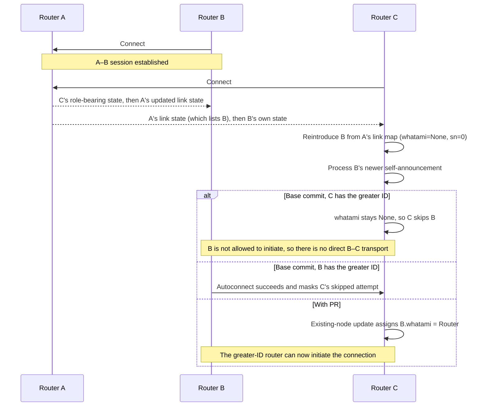

# Zenoh `whatami` regression reproducer

This reproduces the missing node-role assignment addressed by [zenoh#2827](https://github.com/eclipse-zenoh/zenoh/pull/2827), using three real `zenohd` processes.

All three routers have gossip autoconnect enabled for routers and use `autoconnect_strategy: "greater-zid"`. B and C are configured to connect to A. No B–C connection is configured. `greater-zid` allows only the router with the greater Zenoh ID to initiate the automatic connection.



The process result depends on the randomly generated router IDs. On the base commit, the trial reproduces the missing B–C connection when C is the only router allowed to initiate. If B is allowed to initiate, its connection can mask C's `whatami` bug. The PR change makes the role available to C as well.

## Run

Requires Bash and Rust/Cargo 1.97.1 (pinned by Zenoh).

```bash
bash ./run.sh
```

The script builds Zenoh at the base commit and with the PR #2827 role-assignment change, runs the regression test, and runs up to ten base process trials to find the no-connection case. It then runs five process trials with the PR change. Logs and Admin Space snapshots are saved under `.work/`.

## Expected result

The script runs two checks: an internal regression test, then a three-process check.

### 1. Regression test

The [test](regression-test.patch#L11) feeds four events to `Network::link_states()`. Each row links to the test input or assertion.

| Step | Event | Before PR #2827 | With PR #2827 |
| --- | --- | --- | --- |
| 1 | [Register B's per-link ID mapping](regression-test.patch#L36) | Mapping is stored; B's detached graph node is removed | Same |
| 2 | [A announces its link to B](regression-test.patch#L51); C [asserts B has no role and `sn=0`](regression-test.patch#L65) | `whatami=None`, `sn=0` | Same |
| 3 | [B announces itself with `sn=2` and `Router`](regression-test.patch#L69) | Existing B gets `sn=2` and its link to A, but `whatami` stays `None` | Existing B also gets `whatami=Some(Router)` |
| 4 | [Assert B's role](regression-test.patch#L85) | Fails: expected `Some(Router)`, got `None` | Passes: role is `Some(Router)` |

The test reads `net.graph[b_idx].whatami` directly.

### 2. Process check

[`process-repro.sh`](process-repro.sh#L149) starts A, connects B to A, then connects C to A; it waits for both A–B and A–C transports before checking the result. It then:

1. Checks C's Admin Space link-state graph for B: `graph_has_B=yes` ([check](process-repro.sh#L159)).
2. Checks C's log for B's reintroduction from A's link map: `B_reintroduced_at_C=yes` ([check](process-repro.sh#L178)).
3. Queries C's Admin Space for a direct B–C transport: `direct_C_B=no` or `yes` ([query](process-repro.sh#L173)).

A baseline reproduction is `graph_has_B=yes B_reintroduced_at_C=yes direct_C_B=no`. `run.sh` tries up to ten baseline trials because B's autoconnect can establish B–C first and mask C's skipped attempt. With PR #2827, all five trials must report `direct_C_B=yes`. These process checks do not expose `whatami`; the regression test above reads that field directly. Each trial saves its result, logs, and Admin Space snapshots under `.work/` ([snapshots](process-repro.sh#L170), [result](process-repro.sh#L188)).
